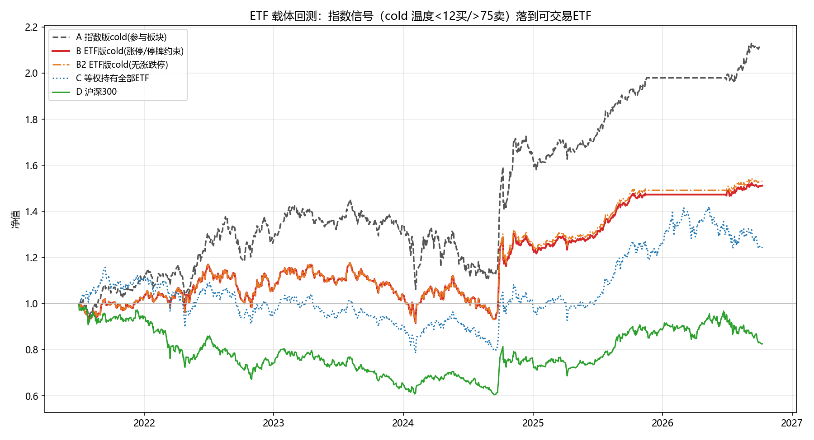

# ETF 载体回测：指数信号 → 可交易 ETF（cold 策略）

生成时间: 2026-10-12 12:39  
窗口: 2021-07-01 ~ 2026-10-09（1277 个交易日）  
参与板块: 26 个（config.ETF_MAP, 无 ETF 的板块不参与）  
参数: cold 温度<12买入 / >75卖出 | 成本0.15%单边 | 最大6仓等权 | 同类≤2 | 涨跌停阈值±9.5% | 买入顺延上限10日

## 一、对比组指标

| 组别 | 说明 | CAGR | 年化波动 | Sharpe | 最大回撤 | 笔数 | 胜率 |
|---|---|---|---|---|---|---|---|
| A | 指数版cold(参与板块n=26) | 15.3% | 17.6% | 0.92 | -26.9% | 20 | 100.0% |
| A+ | 指数版cold(全部30板块, 参考) | 15.9% | 17.8% | 0.95 | -26.9% | 22 | 100.0% |
| B | ETF版cold(涨停/停牌约束) | 8.2% | 15.3% | 0.61 | -22.2% | 18 | 83.3% |
| B2 | ETF版cold(无涨跌停约束) | 8.4% | 15.4% | 0.62 | -22.2% | 19 | 84.2% |
| C | 等权持有全部参与ETF(逐日等权, 零成本) | 4.3% | 18.2% | 0.33 | -32.1% | 0 | - |
| D | 沪深300买入持有 | -3.6% | 17.8% | -0.12 | -39.6% | 0 | - |

- **跟踪拖累 (A−B) = +7.11pp**：指数版年化 15.3% → ETF版年化 8.2%
- **分解**: 纯载体跟踪损耗 (A−B2) = +6.85pp；执行约束影响 (B2−B) = +0.26pp
- **被动基准**: 等权持有全部参与 ETF 年化 4.3%、沪深300 年化 -3.6%；ETF策略(B) 相对等权ETF 超额 +3.9pp/年
- **执行约束统计**: 买入顺延 3 次、卖出顺延 0 次、放弃买入 0 次（连续涨停超 10 日）

## 二、每板块跟踪质量（指数 vs ETF）

日收益相关/beta 只在**指数与 ETF 同日都有真实 K 线**的交易日上计算（同花顺指数源存在缺 K 线, ffill 成零收益会污染统计）; 相关(剔极端日) = 剔除 |日收益|>4% 双侧极端日后的稳健相关, 用于区分'载体跟踪'与'指数源极端日数据噪声'; 指数缺K线 = 参与期内指数源缺 K 线的天数; 年化差 = 指数年化 − ETF年化（ffill 端点法, 缺口不影响端点）。顺延/放弃统计来自 B 组模拟。

| 板块 | ETF代码 | ETF简称 | ETF起始日 | 参与起始日 | 日收益相关 | 相关(剔极端日) | 指数缺K线 | beta(ETF/指数) | 指数年化 | ETF年化 | 年化差(指-ETF) | 买入顺延 | 卖出顺延 | 买入放弃 | 共用 | 载体标注/备注 |
|---|---|---|---|---|---|---|---|---|---|---|---|---|---|---|---|---|
| 煤炭 | sh515220 | 煤炭ETF | 2020-03-02 | 2021-07-01 | 0.957 | 0.932 | 0 | 0.99 | 15.3% | 14.8% | 0.5% | 0 | 0 | 0 |  |  |
| 钢铁 | sh515210 | 钢铁ETF | 2020-03-02 | 2021-07-01 | 0.967 | 0.953 | 0 | 0.97 | 0.1% | -2.8% | 2.9% | 0 | 0 | 0 |  |  |
| 工业金属 | sh512400 | 有色ETF | 2017-09-01 | 2021-07-01 | 0.883 | 0.84 | 0 | 0.97 | 17.7% | 9.0% | 8.7% | 0 | 0 | 0 |  | 申万有色, 铜铝锌为主 |
| 能源金属 | sh516650 | 细分有色ETF | 2021-06-21 | 2021-07-01 | 0.772 | 0.674 | 0 | 0.59 | 1.3% | 10.5% | -9.2% | 0 | 0 | 0 |  | 锂钴镍包含于细分有色, 近似载体 |
| 小金属 | sh516150 | 稀土ETF | 2021-03-17 | 2021-07-01 | 0.903 | 0.86 | 0 | 0.89 | 14.3% | 9.1% | 5.2% | 0 | 0 | 0 |  | 稀土为主 |
| 贵金属 | sh518880 | 黄金ETF | 2013-07-29 | 2021-07-01 | 0.661 | 0.534 | 0 | 0.3 | 26.7% | 17.8% | 8.8% | 0 | 0 | 0 |  | 结构性错配(金价ETF vs 金矿股指数); 跟踪金价而非金矿股, 跟踪差含结构性差异 |
| 油气开采 | sz162411 | 油气LOF | 2012-06-08 | 2021-07-01 | 0.506 | 0.299 | 0 | 0.51 | 11.8% | 15.4% | -3.5% | 0 | 0 | 0 |  | 结构性错配(QDII LOF, 油价+溢价); QDII, 含溢价波动 |
| 石油加工 | sz161129 | 原油LOF | 2017-02-15 | 2021-07-01 | 0.201 | 0.216 | 0 | 0.35 | 7.9% | 17.7% | -9.8% | 0 | 0 | 0 |  | 近似载体(原油LOF vs 炼化股); 跟踪油价, 近似载体 |
| 化学原料 | sz159870 | 化工ETF | 2021-03-03 | 2021-07-01 | 0.782 | 0.739 | 0 | 0.73 | 5.1% | -4.7% | 9.8% | 0 | 0 | 0 | 共用 | 近似载体(共用) |
| 农化制品 | sz159870 | 化工ETF | 2021-03-03 | 2021-07-01 | 0.78 | 0.735 | 0 | 0.75 | 12.6% | -4.7% | 17.3% | 0 | 0 | 0 | 共用 | 近似载体(共用); 与化学原料共用 |
| 水泥建材 | sz159745 | 建材ETF | 2021-06-18 | 2021-07-01 | 0.84 | 0.815 | 0 | 0.89 | 4.7% | -10.7% | 15.4% | 0 | 0 | 0 | 共用 | 近似载体(共用) |
| 玻璃玻纤 | sz159745 | 建材ETF | 2021-06-18 | 2021-07-01 | 0.469 | 0.361 | 0 | 0.4 | 19.8% | -10.7% | 30.5% | 0 | 0 | 0 | 共用 | 近似载体(共用); 与水泥建材共用 |
| 半导体 | sh512480 | 半导体ETF | 2019-06-12 | 2021-07-01 | 0.924 | 0.911 | 0 | 0.9 | 13.0% | 6.8% | 6.2% | 1 | 0 | 0 |  |  |
| 元件 | sz159997 | 电子ETF | 2020-03-20 | 2021-07-01 | 0.842 | 0.789 | 0 | 0.74 | 23.9% | 6.2% | 17.6% | 0 | 0 | 0 | 共用 | 近似载体(共用) |
| 面板 | sz159997 | 电子ETF | 2020-03-20 | 2021-07-01 | 0.75 | 0.724 | 0 | 0.8 | 10.7% | 6.2% | 4.5% | 1 | 0 | 0 | 共用 | 近似载体(共用); 与元件共用 |
| 消费电子 | sz159732 | 消费电子ETF | 2021-08-23 | 2021-08-23 | 0.805 | 0.754 | 0 | 0.79 | 12.6% | 3.3% | 9.2% | 0 | 0 | 0 |  |  |
| 养殖 | sz159865 | 畜牧养殖ETF | 2021-03-08 | 2021-07-01 | 0.876 | 0.839 | 0 | 0.79 | 3.3% | -8.2% | 11.5% | 0 | 0 | 0 | 共用 | 近似载体(共用) |
| 饲料加工 | sz159865 | 畜牧养殖ETF | 2021-03-08 | 2021-07-01 | 0.797 | 0.764 | 0 | 0.8 | 1.7% | -8.2% | 9.9% | 0 | 0 | 0 | 共用 | 近似载体(共用); 与养殖共用, 饲料股在畜牧指数内 |
| 种植种业 | sz159825 | 农业ETF | 2020-12-29 | 2021-07-01 | 0.683 | 0.589 | 0 | 0.48 | 9.5% | -5.3% | 14.8% | 0 | 0 | 0 |  |  |
| 证券 | sh512000 | 券商ETF | 2016-09-14 | 2021-07-01 | 0.974 | 0.965 | 0 | 0.99 | 0.6% | -0.9% | 1.5% | 1 | 0 | 0 |  |  |
| 保险 | sh512070 | 证券保险ETF | 2015-08-04 | 2021-07-01 | 0.83 | 0.762 | 0 | 0.8 | 2.5% | 0.2% | 2.3% | 0 | 0 | 0 |  | 证券保险合并, 与证券共用 |
| 房地产 | sh512200 | 房地产ETF | 2017-09-25 | 2021-07-01 | 0.922 | 0.894 | 0 | 0.97 | 1.1% | -9.8% | 10.8% | 0 | 0 | 0 |  |  |
| 基建建筑 | sh516970 | 基建工程ETF | 2021-07-05 | 2021-07-05 | 0.737 | 0.704 | 0 | 0.69 | 7.8% | 1.5% | 6.3% | 0 | 0 | 0 | 共用 | 近似载体(共用) |
| 工程机械 | sh516970 | 基建工程ETF | 2021-07-05 | 2021-07-05 | 0.616 | 0.523 | 0 | 0.57 | 9.5% | 1.5% | 8.0% | 0 | 0 | 0 | 共用 | 近似载体(共用); 与基建共用 |
| 汽车整车 | sh516110 | 汽车ETF | 2021-05-07 | 2021-07-01 | 0.843 | 0.794 | 0 | 0.79 | 2.3% | -2.0% | 4.2% | 0 | 0 | 0 |  |  |
| 电力 | sz159611 | 电力ETF | 2022-01-07 | 2022-01-07 | 0.869 | 0.845 | 0 | 0.73 | 5.1% | 2.2% | 2.9% | 0 | 0 | 0 |  | 2022年上市, 历史较短 |

**载体真实错配板块（日收益相关<0.85 且 剔极端日后仍<0.85）**: 能源金属, 贵金属, 油气开采, 石油加工, 化学原料, 农化制品, 水泥建材, 玻璃玻纤, 元件, 面板, 消费电子, 饲料加工, 种植种业, 保险, 基建建筑, 工程机械, 汽车整车——载体与指数真实错位（结构性错配/近似载体）, 实盘需降权或替代。

## 三、结论（用数据说话）

1. **跟踪拖累 +7.11pp/年**。同一套 cold 信号（12/75）, 在指数上年化 15.3%, 落到可交易 ETF 上年化 8.2%。分解: 载体跟踪误差贡献 +6.85pp, 涨跌停/停牌执行约束贡献 +0.26pp。
2. **执行约束影响 较小**: 窗口内买入顺延 3 次、卖出顺延 0 次、放弃买入 0 次，对年化影响 +0.26pp。行业 ETF 极少连续涨停/跌停, 该约束主要在极端行情（如复牌补涨、2024/9 底部暴涨）中起作用。
3. **载体失真判定**（以'相关(剔极端日)'列为准）: **真实载体错配 17 个**（全量相关<0.85 且剔极端日后仍<0.85）: 能源金属, 贵金属, 油气开采, 石油加工, 化学原料, 农化制品, 水泥建材, 玻璃玻纤, 元件, 面板, 消费电子, 饲料加工, 种植种业, 保险, 基建建筑, 工程机械, 汽车整车——结构性错配（贵金属=金价ETF vs 金矿股、油气=QDII LOF、石油加工=原油LOF vs 炼化股）与共用近似载体属此类, 实盘应降权或替代。
4. **ETF 实盘可行性**: 策略 B 年化 8.2%、Sharpe 0.61、最大回撤 -22.2%，相对沪深300 年化超额 +11.7pp。跟踪拖累 7.1pp/年 是实盘必须接受的成本（其中执行约束仅 0.3pp, 大头是载体跟踪误差）；建议: 真实载体错配板块（能源金属, 贵金属, 油气开采, 石油加工, 化学原料, 农化制品, 水泥建材, 玻璃玻纤, 元件, 面板, 消费电子, 饲料加工, 种植种业, 保险, 基建建筑, 工程机械, 汽车整车）降权或替代, 其余板块（含剔极端日相关达标的'噪声'板块）指数信号可直接映射到 ETF 执行。

## 四、方法与口径

- **信号**: `strategy.position_target(指数df, mode='cold', enter/exit)` —— 与指数版完全同源; 候选排序用 `strategy.signal_strength`（指数侧动量+相对强度+温度斜率）。
- **时序**: 镜像 `run_backtest` 代码行为——T 日收盘用指数数据算信号、T 日收盘价成交（等价于'信号日收盘调仓, 仓位自 T+1 起承担收益'）; 组合 max_positions 等权、卖出优先、空位当日可回补、同类上限 per_category_max、成本=当日换手×单边费率。
- **A 组口径**: 直接调用 `run_backtest`(mode='cold', trailing_stop=False), 参与板块与窗口同 B 组, 保证 A−B 只反映载体/执行差异。（关闭移动止损是为了与 ETF 版的纯温度迟滞信号严格一致。）
- **涨停约束**: 成交日 ETF 当日涨幅 ≥ +9.5% 时买入顺延（连续尝试, 超 10 个交易日放弃并封锁至信号归零）; 跌幅 ≤ −9.5% 时卖出顺延（次日继续尝试, 能卖的第一天卖出）。停牌（当日无 K 线）顺延到下一个有 K 线的日子, 估值用最近可用价 ffill。`--no-limit` 仅关闭涨跌停顺延。
- **价格复权**: ETF 行情取自 `data.get_etf_hist`（adjusted=True）, 已由 `data.adjust_etf_prices` 完成份额折算/合并修复（新浪源不复权, 2021-2026 内 universe 有 6 起单日 ±50~170% 的人为价格缺口——如 房地产ETF 2024-08-12 合并、煤炭/券商/半导体ETF 拆分——不修复会把折算当暴涨、拆分当腰斩, 收益与相关性完全失真）和分红除息的近似全收益复权（分红数据可见的品种, 约 7/21）。涨跌停判定、相关性与年化均基于复权后价格。
- **可复现性**: ETF 行情经私有快照缓存 `output/etf_cache/`（首次运行从共享缓存导入后冻结）, 配 `--offline` 只读快照, 隔离其他进程对共享缓存的并发重写; 本任务执行期间共享缓存曾反复变更, 导致同日两次运行结果不同, 快照机制保证本报告数字可复现。每交易日删除快照目录即可换新数据。
- **参与起点**: ETF 上市晚于窗口起点的板块从其 ETF 上市日起参与（如电力ETF 2022 年上市）; 等权基准 C 中各板块亦自上市日起计入。
- **C 组实现**: 逐日等权（当日有数据的参与 ETF 等权平均日收益, 逐日再平衡）、零成本——最简单的被动基准近似, 未计再平衡成本。
- **跟踪质量口径**: 日收益相关/beta 只用指数与 ETF 同日都有真实 K 线的交易日（指数源缺 K 线的日期不计入, 避免零收益污染）; '相关(剔极端日)'剔除双侧 |日收益|>4% 的日子; 年化收益用 ffill 端点值计算。指数缺 K 线属同花顺指数源问题（如煤炭 2023 年全年缺失）, 在模拟中按引擎口径该板块目标仓位记 0, A/B 两组同等受限。
- **数据**: 信号= data/enriched.pkl（行业指数富化）; ETF= `data.get_etf_hist`（新浪源, 本地缓存）; 基准= `data.get_benchmark`（沪深300）。单只 ETF 拉取失败自动跳过该板块。
