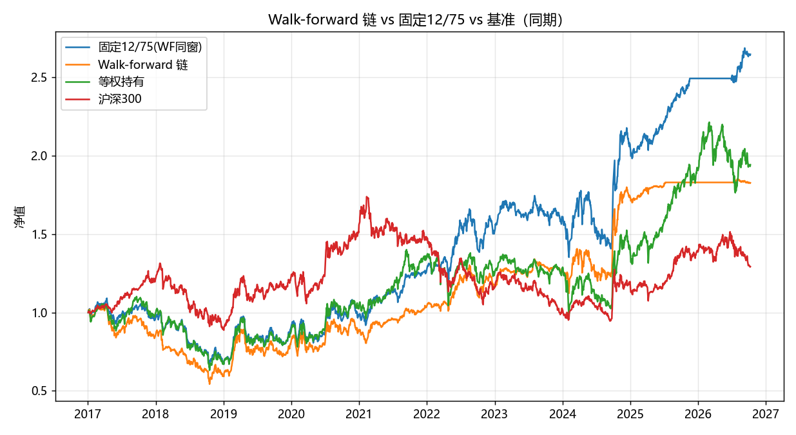

# 深寒策略样本外验证与参数敏感性报告

- 生成: 2026-10-12 12:38 | 模式: 全量 | 回测次数: 171 | 耗时 518s
- 数据: enriched.pkl, 30 板块, 2010-01-04 ~ 2026-10-09 | 成本默认单边 0.15% | cold 模式(等权6仓,移动止损25%)

## 1. 全样本参数网格（enter_below × exit_above, mode=cold）

### Sharpe 矩阵（行=enter, 列=exit, ★=默认 12/75）

| enter\exit | 65 | 70 | 75 | 80 | 85 |
| --- | --- | --- | --- | --- | --- |
| 8 | 0.42 | 0.45 | 0.52 | 0.57 | 0.44 |
| 10 | 0.58 | 0.57 | 0.57 | 0.54 | 0.40 |
| **12** | 0.56 | 0.60 | 0.58 ★ | 0.55 | 0.47 |
| 15 | 0.40 | 0.42 | 0.35 | 0.40 | 0.35 |
| 20 | 0.21 | 0.27 | 0.26 | 0.31 | 0.31 |

### CAGR 矩阵（%）

| enter\exit | 65 | 70 | 75 | 80 | 85 |
| --- | --- | --- | --- | --- | --- |
| 8 | 5.7% | 6.2% | 7.6% | 9.0% | 7.0% |
| 10 | 9.5% | 9.5% | 9.8% | 9.3% | 6.6% |
| **12** | 9.6% | 10.6% | 10.5% ★ | 9.9% | 8.3% |
| 15 | 6.2% | 6.8% | 5.3% | 6.5% | 5.6% |
| 20 | 2.1% | 3.5% | 3.2% | 4.5% | 4.5% |

### 平台/孤峰判断（容差 0.15 Sharpe）

12/75 与相邻格子的 Sharpe 对比:

| 相邻方向 | 格子 | Sharpe | |差| |
| --- | --- | --- | --- |
| enter降1档 | (10,75) | 0.57 | 0.01 |
| enter升1档 | (15,75) | 0.35 | 0.23 |
| exit降1档 | (12,70) | 0.60 | 0.02 |
| exit升1档 | (12,80) | 0.55 | 0.03 |

判断: 12/75 Sharpe=0.58, 在 25 个格子中排第 3 名; 最优格 (12, 70) Sharpe=0.60。→ **孤峰**（相邻格最大 Sharpe 差 0.23 ≥ 0.15, 12/75 处于孤立高点, 事后选参风险高）

## 2. Walk-forward 滚动验证（扩展窗, 5 折）

每折: 训练期跑同一网格 → 选 Sharpe 最高（平手取 CAGR 高）→ 测试期用选中参数回测（同一折同时给出固定 12/75 的测试期成绩作对照）。

| 折 | 训练期 | 测试期 | 选中参数(e/x) | 训练Sharpe | 测试年化 | 测试Sharpe | 测试MDD | 测试总收益 | 笔数 | 测试胜率 | 固定12/75年化 | 固定Sharpe |
| --- | --- | --- | --- | --- | --- | --- | --- | --- | --- | --- | --- | --- |
| 折1 | ≤2016-12-31 | 2017-01-01~2018-12-31 | 10/85 | 0.60 | -23.1% | -1.32 | -48.0% | -40.6% | 17 | 5.9% | -17.6% | -0.98 |
| 折2 | ≤2018-12-31 | 2019-01-01~2020-12-31 | 10/70 | 0.31 | 22.5% | 0.94 | -19.4% | 49.9% | 16 | 75.0% | 18.9% | 0.82 |
| 折3 | ≤2020-12-31 | 2021-01-01~2022-12-31 | 10/65 | 0.45 | 14.5% | 1.09 | -16.0% | 30.8% | 10 | 90.0% | 22.1% | 1.33 |
| 折4 | ≤2022-12-31 | 2023-01-01~2024-12-31 | 10/65 | 0.52 | 22.0% | 1.14 | -16.2% | 48.6% | 21 | 71.4% | 15.2% | 0.76 |
| 折5 | ≤2024-12-31 | 2025-01-01~末尾 | 10/65 | 0.60 | 3.1% | 0.96 | -2.2% | 5.6% | 2 | 100.0% | 15.9% | 1.96 |

各折选中参数: 10/85, 10/70, 10/65, 10/65, 10/65（默认 12/75）

### 测试段权益链（各段从1起、链式相接） vs 对照

| 方案 | 区间 | 总收益 | 年化 | Sharpe | 最大回撤 | 年化波动 |
| --- | --- | --- | --- | --- | --- | --- |
| 固定12/75 全样本 | 2010-01-04~2026-10-09 | 430.2% | 10.5% | 0.58 | -43.9% | 21.7% |
| 固定12/75 WF同窗 | 2017-01-01~2026-10-09 | 164.9% | 10.5% | 0.63 | -40.6% | 19.3% |
| Walk-forward 链 | 2017-01-01~2026-10-09 | 82.6% | 6.4% | 0.44 | -48.0% | 18.2% |
| 等权持有 | 2017-01-01~2026-10-09 | 94.1% | 7.0% | 0.43 | -42.6% | 21.8% |
| 等权持有 | 2010-01-04~2026-10-09 | 326.7% | 9.0% | 0.48 | -53.0% | 25.2% |
| 沪深300 | 2017-01-01~2026-10-09 | 29.2% | 2.7% | 0.24 | -45.6% | 18.5% |
| 沪深300 | 2010-01-04~2026-10-09 | 22.1% | 1.2% | 0.16 | -46.7% | 21.4% |

**过拟合衰减（题设口径）= 固定12/75全样本年化 − WF链年化 = 10.5% − 6.4% = **+4.1 个百分点**

参考（同窗口径）: WF同窗固定12/75 年化 10.5% − WF链 6.4% = +4.1 个百分点（剔除'时间段不同'的影响后的纯选参衰减）

## 3. 温度权重敏感性（5 种权重方案重算温度 → cold 12/75）

| 权重方案(价/动/估/广/量) | 年化 | Sharpe | MDD | 年化波动 | 笔数 | 总收益 |
| --- | --- | --- | --- | --- | --- | --- |
| 默认 25/25/25/15/10 | 10.5% | 0.58 | -43.9% | 21.7% | 168 | 430.2% |
| 等权 20/20/20/20/20 | 7.2% | 0.44 | -52.8% | 21.9% | 172 | 222.4% |
| 价格估值重 35/15/35/7.5/7.5 | 10.5% | 0.62 | -37.7% | 19.9% | 140 | 435.7% |
| 动量重 15/40/20/12.5/12.5 | 6.4% | 0.40 | -52.1% | 22.1% | 197 | 181.2% |
| 纯价格估值 50/0/50/0/0 | 7.1% | 0.49 | -41.2% | 17.6% | 93 | 213.3% |

温度重算自检: 默认方案重算温度与富化缓存温度最大绝对差 4.26e-14。五方案年化区间 [6.4%, 10.5%], 极差 4.2%; Sharpe 区间 [0.40, 0.62]。

## 4. 成本压力测试（cold 12/75, 全样本）

| 单边成本 | 年化 | Sharpe | MDD | 笔数 | 总收益 |
| --- | --- | --- | --- | --- | --- |
| 0.05% | 10.9% | 0.60 | -43.4% | 168 | 462.7% |
| 0.15% | 10.5% | 0.58 | -43.9% | 168 | 430.2% |
| 0.30% | 9.9% | 0.56 | -44.7% | 168 | 384.9% |
| 0.50% | 9.1% | 0.52 | -45.8% | 168 | 330.4% |

成本 0.05% → 0.50% 年化从 10.9% 降到 9.1%，降幅 1.8%。

## 5. 结论

- **参数形状**: 12/75 在 5x5 网格中排第 3/25 名（Sharpe 0.58，最优格 (12, 70) = 0.60），与相邻格最大 Sharpe 差 0.23，判定为孤峰（存在相邻格差 ≥ 0.15）。
- **过拟合衰减**: 固定12/75全样本年化 10.5%，walk-forward 链年化 6.4%，衰减 +4.1 个百分点（同窗口径 +4.1 个百分点）。各折 WF 选中参数（10/85, 10/70, 10/65, 10/65, 10/65）与默认 12/75 的偏离情况见第2节表。
- **权重敏感性**: 5 种温度权重方案年化 6.4% ~ 10.5%（极差 4.2%），全部为正，Sharpe 0.40 ~ 0.62，结论对温度构成方式有一定敏感。
- **成本压力**: 单边成本 0.05%~0.50%，年化 10.9% → 9.1%（每提高 0.1% 成本约损失年化 0.4 个百分点），默认 0.15% 假设下年化 10.5%。
- **相对基准**: WF同窗内策略（固定 10.5% / WF链 6.4%）对等权持有（7.0%）仍有超额。
- **总体判断: 存在明显过拟合证据**——参数是孤峰;  '年化14.6%' 不能作为实盘预期。

产物: wf_grid_full.csv（Sharpe+CAGR 矩阵）, wf_grid_sharpe/cagr/rows_full.csv, wf_folds_full.csv, wf_train_grids_full.csv, wf_equity_chain_full.csv, wf_comparison_full.csv, weight_sensitivity_full.csv, cost_stress_full.csv, wf_grid_heatmap_full.png, wf_equity_full.png
