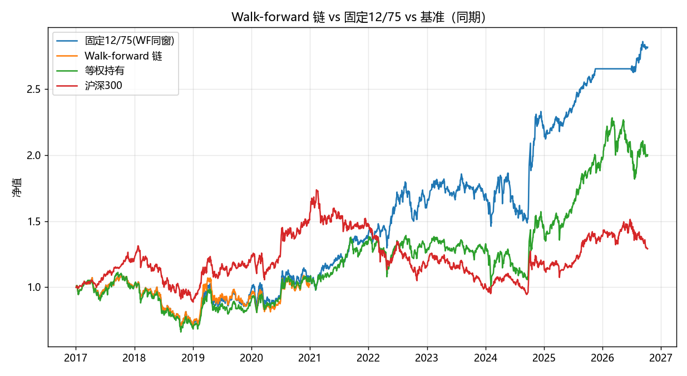

# 深寒策略样本外验证与参数敏感性报告

- 生成: 2026-10-12 11:29 | 模式: quick 自测 | 回测次数: 27 | 耗时 82s
- 数据: enriched.pkl, 30 板块, 2010-01-04 ~ 2026-10-09 | 成本默认单边 0.15% | cold 模式(等权6仓,移动止损25%)

## 1. 全样本参数网格（enter_below × exit_above, mode=cold）

### Sharpe 矩阵（行=enter, 列=exit, ★=默认 12/75）

| enter\exit | 70 | 75 |
| --- | --- | --- |
| 10 | 0.60 | 0.62 |
| **12** | 0.60 | 0.60 ★ |

### CAGR 矩阵（%）

| enter\exit | 70 | 75 |
| --- | --- | --- |
| 10 | 9.9% | 10.8% |
| **12** | 10.6% | 11.1% ★ |

### 平台/孤峰判断（容差 0.15 Sharpe）

12/75 与相邻格子的 Sharpe 对比:

| 相邻方向 | 格子 | Sharpe | |差| |
| --- | --- | --- | --- |
| enter降1档 | (10,75) | 0.62 | 0.02 |
| exit降1档 | (12,70) | 0.60 | 0.01 |

判断: 12/75 Sharpe=0.60, 在 4 个格子中排第 2 名; 最优格 (10, 75) Sharpe=0.62。→ **平台**（相邻格最大 Sharpe 差 0.02 < 0.15, 12/75 的成绩不是靠卡某一个格子）

## 2. Walk-forward 滚动验证（扩展窗, 2 折）

每折: 训练期跑同一网格 → 选 Sharpe 最高（平手取 CAGR 高）→ 测试期用选中参数回测（同一折同时给出固定 12/75 的测试期成绩作对照）。

| 折 | 训练期 | 测试期 | 选中参数(e/x) | 训练Sharpe | 测试年化 | 测试Sharpe | 测试MDD | 测试总收益 | 笔数 | 测试胜率 | 固定12/75年化 | 固定Sharpe |
| --- | --- | --- | --- | --- | --- | --- | --- | --- | --- | --- | --- | --- |
| 折1 | ≤2016-12-31 | 2017-01-01~2018-12-31 | 12/75 | 0.54 | -15.6% | -0.84 | -37.6% | -28.5% | 19 | 26.3% | -15.6% | -0.84 |
| 折2 | ≤2018-12-31 | 2019-01-01~2020-12-31 | 10/75 | 0.35 | 19.9% | 0.84 | -24.5% | 43.7% | 16 | 56.2% | 23.3% | 0.96 |

各折选中参数: 12/75, 10/75（默认 12/75）

### 测试段权益链（各段从1起、链式相接） vs 对照

| 方案 | 区间 | 总收益 | 年化 | Sharpe | 最大回撤 | 年化波动 |
| --- | --- | --- | --- | --- | --- | --- |
| 固定12/75 全样本 | 2010-01-04~2026-10-09 | 480.9% | 11.1% | 0.60 | -39.9% | 21.8% |
| 固定12/75 WF同窗 | 2017-01-01~2020-12-31 | 182.2% | 11.2% | 0.66 | -37.6% | 19.6% |
| Walk-forward 链 | 2017-01-01~2020-12-31 | 2.6% | 0.6% | 0.14 | -37.6% | 22.7% |
| 等权持有 | 2017-01-01~2020-12-31 | 100.3% | 7.4% | 0.46 | -40.6% | 20.8% |
| 等权持有 | 2010-01-04~2026-10-09 | 346.5% | 9.3% | 0.51 | -50.2% | 23.9% |
| 沪深300 | 2017-01-01~2020-12-31 | 29.2% | 2.7% | 0.24 | -45.6% | 18.5% |
| 沪深300 | 2010-01-04~2026-10-09 | 22.1% | 1.2% | 0.16 | -46.7% | 21.4% |

**过拟合衰减（题设口径）= 固定12/75全样本年化 − WF链年化 = 11.1% − 0.6% = **+10.4 个百分点**

参考（同窗口径）: WF同窗固定12/75 年化 11.2% − WF链 0.6% = +10.6 个百分点（剔除'时间段不同'的影响后的纯选参衰减）

## 3. 温度权重敏感性（5 种权重方案重算温度 → cold 12/75）

| 权重方案(价/动/估/广/量) | 年化 | Sharpe | MDD | 年化波动 | 笔数 | 总收益 |
| --- | --- | --- | --- | --- | --- | --- |
| 默认 25/25/25/15/10 | 11.1% | 0.60 | -39.9% | 21.8% | 169 | 480.9% |
| 等权 20/20/20/20/20 | 8.2% | 0.48 | -51.7% | 22.0% | 173 | 275.0% |
| 价格估值重 35/15/35/7.5/7.5 | 9.9% | 0.59 | -39.1% | 19.8% | 139 | 385.1% |
| 动量重 15/40/20/12.5/12.5 | 7.6% | 0.45 | -50.2% | 22.0% | 207 | 240.5% |
| 纯价格估值 50/0/50/0/0 | 7.9% | 0.53 | -41.2% | 17.7% | 89 | 255.8% |

温度重算自检: 默认方案重算温度与富化缓存温度最大绝对差 4.26e-14。五方案年化区间 [7.6%, 11.1%], 极差 3.5%; Sharpe 区间 [0.45, 0.60]。

## 4. 成本压力测试（cold 12/75, 全样本）

| 单边成本 | 年化 | Sharpe | MDD | 笔数 | 总收益 |
| --- | --- | --- | --- | --- | --- |
| 0.05% | 11.5% | 0.62 | -39.4% | 169 | 517.4% |
| 0.15% | 11.1% | 0.60 | -39.9% | 169 | 480.9% |
| 0.30% | 10.5% | 0.58 | -40.6% | 169 | 430.2% |
| 0.50% | 9.7% | 0.54 | -41.5% | 169 | 369.4% |

成本 0.05% → 0.50% 年化从 11.5% 降到 9.7%，降幅 1.8%。

## 5. 结论

- **参数形状**: 12/75 在 5x5 网格中排第 2/4 名（Sharpe 0.60，最优格 (10, 75) = 0.62），与相邻格最大 Sharpe 差 0.02，判定为平台（相邻格差全部 < 0.15）。
- **过拟合衰减**: 固定12/75全样本年化 11.1%，walk-forward 链年化 0.6%，衰减 +10.4 个百分点（同窗口径 +10.6 个百分点）。各折 WF 选中参数（12/75, 10/75）与默认 12/75 的偏离情况见第2节表。
- **权重敏感性**: 5 种温度权重方案年化 7.6% ~ 11.1%（极差 3.5%），全部为正，Sharpe 0.45 ~ 0.60，结论对温度构成方式有一定敏感。
- **成本压力**: 单边成本 0.05%~0.50%，年化 11.5% → 9.7%（每提高 0.1% 成本约损失年化 0.4 个百分点），默认 0.15% 假设下年化 11.1%。
- **相对基准**: WF同窗内策略（固定 11.2% / WF链 0.6%）对等权持有（7.4%）仍有超额。
- **总体判断: 存在明显过拟合证据**——walk-forward 衰减 10.4 个百分点;  '年化14.6%' 不能作为实盘预期。

产物: wf_grid_quick.csv（Sharpe+CAGR 矩阵）, wf_grid_sharpe/cagr/rows_quick.csv, wf_folds_quick.csv, wf_train_grids_quick.csv, wf_equity_chain_quick.csv, wf_comparison_quick.csv, weight_sensitivity_quick.csv, cost_stress_quick.csv, wf_grid_heatmap_quick.png, wf_equity_quick.png
